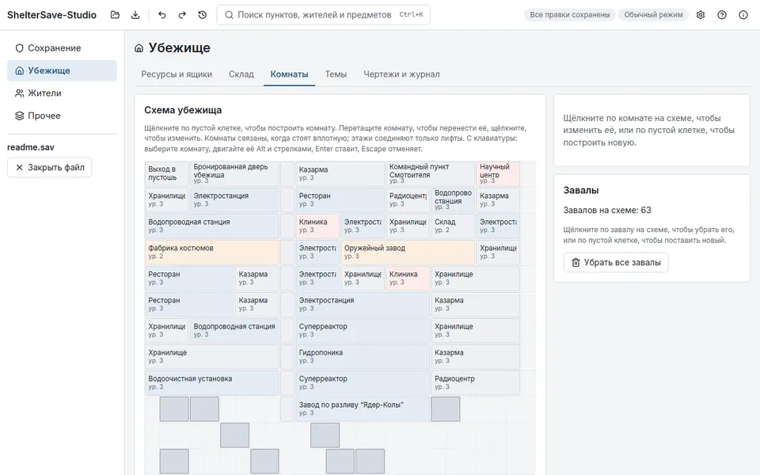
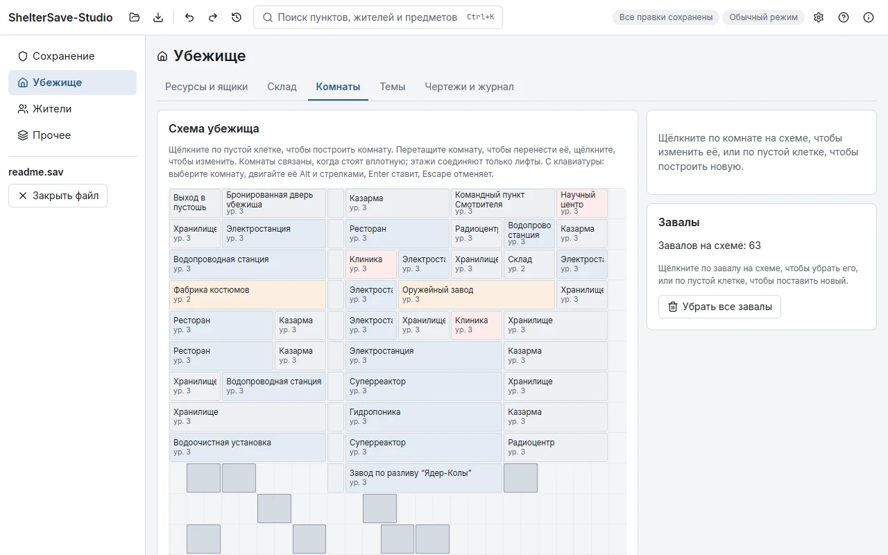
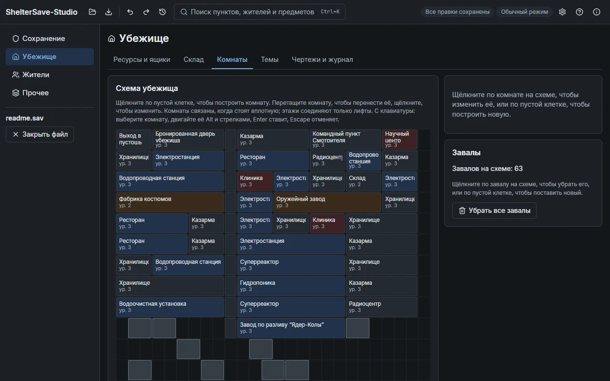
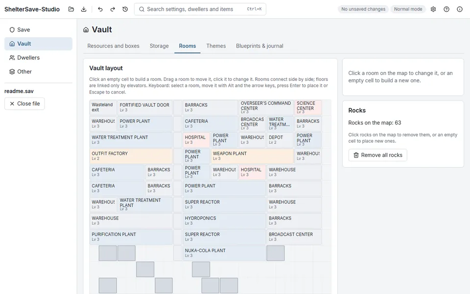
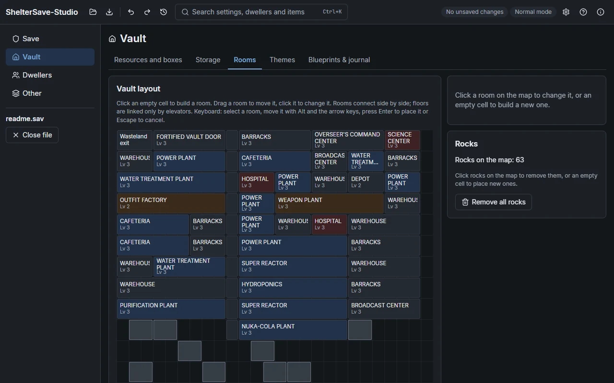
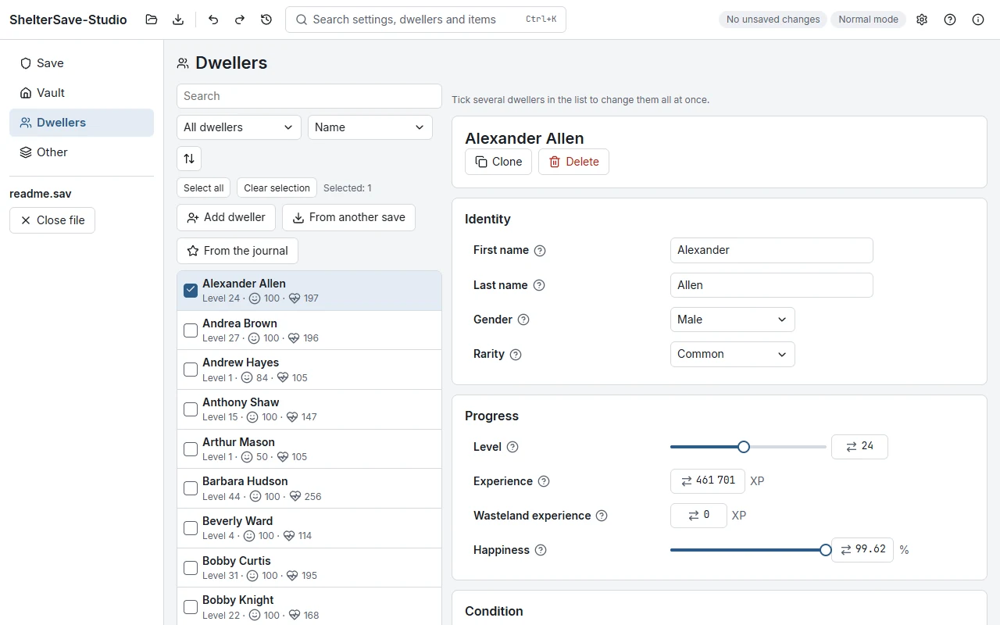
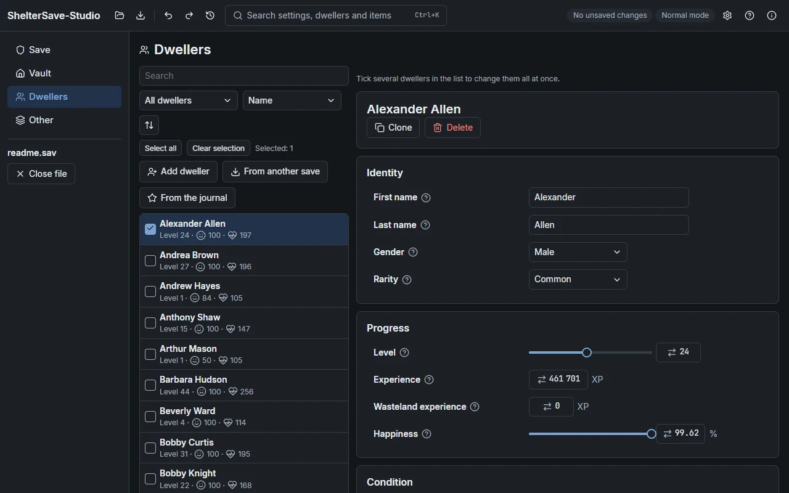

<div align="center">


# ShelterSave-Studio

**Редактор сохранений Fallout Shelter для ПК и браузера**
<br>
**Fallout Shelter save editor for desktop and the web**

[](https://github.com/Mahiron-hq/ShelterSave-Studio/releases/latest)
[](https://github.com/Mahiron-hq/ShelterSave-Studio/actions/workflows/ci.yml)
[](LICENSE)
[](#установка)
[](https://www.rust-lang.org/)

### [⬇️ Скачать / Download](https://github.com/Mahiron-hq/ShelterSave-Studio/releases/latest) · [🌐 Веб-версия / Web version](https://shelter.mahiron.online)

**[Русский](#русский)** · **[English](#english)**

</div>

---

## Русский

ShelterSave-Studio открывает файл сохранения Fallout Shelter, показывает всё, что в нём есть, и позволяет это изменить: ресурсы, комнаты, жителей, задания, пустошь, происшествия и многое другое. Есть ПК-версия для Windows, Linux и macOS и [веб-версия](https://shelter.mahiron.online/ru/) с тем же редактором. Обе версии дают одинаковый файл после одинаковых правок.



| Светлая тема | Тёмная тема |
|---|---|
|  |  |
|  |  |

### Возможности

- **Всё содержимое сохранения:** ресурсы и ящики, склад, комнаты, темы, чертежи и рецепты, жители, внешность, снаряжение, питомцы, Мистер Помощник, семьи и дети, задания и цели, достижения, пустошь, происшествия, события и таймеры.
- **Карта убежища.** Комнату можно перетащить мышью, объединить, разделить, скопировать, построить новую, убрать или поставить завалы. Редактор проверяет, что комната помещается и связана с лифтом.
- **Проверка целостности.** Перед записью редактор ищет то, из-за чего игра падает или зависает, например мастерскую не того размера или неоткрытую комнату, и предлагает исправить.
- **Отмена и повтор любой правки,** журнал правок и список всех изменений перед записью.
- **Файл не меняется без нужды.** Сохранение без правок совпадает с исходным побайтно: числа, порядок ключей и неизвестные поля остаются как были.
- **Обычный и экспертный режим.** В обычном режиме значения не выходят за пределы, которые принимает игра. Экспертный режим открывает любой ключ файла и дерево JSON.
- **Картинки и фразы из вашей игры.** Предметы, комнаты, темы, житель в полный рост и дневник отряда в пустоши. В редакторе нет файлов игры: ПК-версия читает их из установленной игры, сайт — из файла игры, который вы выберете сами.
- **Происшествия:** пожар или нашествие в нужной комнате, сила, завершение, пауза случайных происшествий.
- **Задания и цели:** заменить, выполнить, изменить сложность, забыть пройденные задания. Достижения с прогрессом.
- **Дети и семьи:** будущие дети (редкость, близнецы, цвета), беременность, партнёры, предки.
- **Перенос жителя из другого сохранения,** легендарные жители и питомцы из журнала игры.
- **ПК-версия** сама находит сохранения, делает резервные копии, замечает, что игра сохранила файл, восстанавливает правки после сбоя и не выходит в сеть.
- **Интерфейс на русском и английском,** названия предметов из официальной русской локализации игры. Светлая и тёмная темы.

#### Чем он отличается от других редакторов

Сведения о других редакторах взяты из их страниц и репозиториев (ноябрь 2026).

- **[Shelter Editor](https://github.com/rakion99/shelter-editor)** (rakion99, браузер). Ресурсы, режим и тема убежища, массовые действия (убрать камни, открыть все комнаты и рецепты, SPECIAL на максимум, вылечить всех), имя, пол, здоровье, уровень, цвет кожи и волос, снаряжение жителей, отряды в пустоши. Отдельные комнаты, задания и питомцы не редактируются.
- **[Wasteland Editor](https://github.com/devvyyxyz/wasteland-editor)** (devvyyxyz, браузер). Ресурсы, жители с внешностью и SPECIAL, склад, список комнат и просмотр планировки, отряды, сезонный пропуск, рецепты, темы, история изменений, проверка файла. По списку планов авторов пока нет отмены правок, редактора заданий, питомцев, детей, происшествий и карты планировки.
- **[FSSE](https://github.com/robot9706/FSSE)** (robot9706, Windows и Android). Репозиторий в архиве с 2020 года, программа не обновляется.
- **[FOSE](https://github.com/goobycorp/fose)** (GoobyCorp). Скрипт командной строки: расшифровывает и зашифровывает файл, править JSON нужно вручную.

Только в ShelterSave-Studio: карта убежища с перестановкой комнат мышью, проверка целостности по коду игры, побайтно точная запись, отмена любой правки, пределы значений из данных игры, картинки и внешность жителей из вашей игры, происшествия, задания и цели, будущие дети, перенос жителей между сохранениями, расшифрованный дневник отряда.

### Установка

Все файлы лежат на странице [последнего выпуска](https://github.com/Mahiron-hq/ShelterSave-Studio/releases/latest). Контрольные суммы SHA-256 — в файле `SHA256SUMS.txt` там же.

| Система | Файл |
|---|---|
| Windows 10 и 11 (x64) | `ShelterSave-Studio-1.0.0-windows-x64-setup.exe` — установщик; `…-windows-x64-portable.exe` — работает без установки |
| Linux (x64) | `…-linux-x64.AppImage`, `…-linux-x64.deb` (Debian, Ubuntu), `…-linux-x64.rpm` (Fedora, openSUSE) |
| macOS 11 и новее, Apple Silicon | `…-macos-arm64.dmg` или `…-macos-arm64.zip` |
| macOS 11 и новее, Intel | `…-macos-x64.dmg` или `…-macos-x64.zip` |
| Любой современный браузер | [shelter.mahiron.online](https://shelter.mahiron.online/ru/), установка не нужна |

- **Windows.** Установщик ставит программу только для текущего пользователя, права администратора не нужны. Он создаёт ярлыки, может связать файлы `.sav` с программой и удаляется через «Параметры → Приложения».
- **Linux.** `.deb`: `sudo apt install ./ShelterSave-Studio-1.0.0-linux-x64.deb`; `.rpm`: `sudo dnf install ./ShelterSave-Studio-1.0.0-linux-x64.rpm`; AppImage: `chmod +x` и запуск.
- **macOS.** Откройте `.dmg` и перетащите программу в «Программы» или распакуйте `.zip`.

Проверка файла: `Get-FileHash -Algorithm SHA256 <файл>` в PowerShell или `sha256sum <файл>` в Linux и macOS. Результат должен совпасть со строкой в `SHA256SUMS.txt`.

#### Предупреждение о неподписанной программе

Сборки не подписаны платным сертификатом разработчика, поэтому система предупредит о неизвестном издателе. Это ожидаемо; целостность файла проверяется по контрольной сумме.

- **Windows (SmartScreen):** нажмите «Подробнее», затем «Выполнить в любом случае».
- **macOS 15 и новее:** при первом запуске появится сообщение, что программу не удалось проверить. Закройте его, откройте «Системные настройки → Конфиденциальность и безопасность», внизу нажмите «Всё равно открыть» и подтвердите паролем. На macOS 11–14 достаточно открыть программу через правую кнопку мыши → «Открыть». Вместо этого можно выполнить в Терминале: `xattr -dr com.apple.quarantine /Applications/ShelterSave-Studio.app`.

### Как пользоваться

1. **Закройте игру.** Запущенная игра запишет своё состояние поверх изменённого файла.
2. **Откройте сохранение.** ПК-версия сама показывает найденные убежища. На сайте перетащите файл на страницу или нажмите «Выбрать файл». В игре три ячейки, поэтому файлы всегда называются `Vault1.sav`, `Vault2.sav` и `Vault3.sav`.
   - Windows, Steam и Bethesda.net: `%LOCALAPPDATA%\FalloutShelter`.
   - Linux, Steam через Proton: `~/.steam/steam/steamapps/compatdata/588430/pfx/drive_c/users/steamuser/AppData/Local/FalloutShelter`.
   - Android: `Android/data/com.bethsoft.falloutshelter/files` (на Android 11 и новее — через компьютер по USB).
3. **Измените то, что нужно.** У каждого пункта есть пояснение: наведите указатель на знак вопроса. Поиск по пунктам, жителям и предметам — Ctrl+K.
4. **Запишите файл.** Редактор покажет все изменения и проверит файл. ПК-версия перед первой записью делает резервную копию и записывает файл на место. Сайт отдаёт файл для скачивания: положите его в папку сохранений под тем же именем вместо старого.
5. **Запустите игру.** Если игра синхронизирует сохранения через облако, отключите синхронизацию на время правки, иначе облачная копия может заменить ваш файл.

Подробная справка: [shelter.mahiron.online/ru/help/](https://shelter.mahiron.online/ru/help/).

### Сборка из исходников

Нужен [Rust](https://www.rust-lang.org/) 1.95 или новее. В Linux также нужны `libxkbcommon-dev libwayland-dev libgl1-mesa-dev libxcb1-dev`.

```sh
git clone https://github.com/Mahiron-hq/ShelterSave-Studio
cd ShelterSave-Studio
cargo run --release -p shelter-save-studio      # ПК-версия
cargo test --workspace                           # тесты
```

Веб-версия и сервер сайта дополнительно требуют Node.js 24, цель `wasm32-unknown-unknown`, `wasm-bindgen-cli` 0.2.130 и `wasm-opt` из [binaryen](https://github.com/WebAssembly/binaryen) (путь к нему — в переменной `WASM_OPT`):

```sh
rustup target add wasm32-unknown-unknown
cargo install --locked wasm-bindgen-cli --version 0.2.130
cd web && npm ci && npm run build && cd ..        # сайт в web/dist
cargo build --release -p shelter-site            # сервер со встроенным сайтом
```

Установщик для Windows собирается из готовой программы: укажите полный путь к ней в `SHELTER_PAYLOAD` и выполните `cargo build --release -p shelter-save-studio-setup`. Установка сервера на Debian описана в [deploy/INSTALL.ru.md](deploy/INSTALL.ru.md).

### Как это устроено

- `crates/core` — общее ядро: расшифровка и шифрование (AES-256-CBC, [описание формата](docs/SAV_FORMAT.md)), JSON без потерь (числа и строки хранятся в исходном виде, порядок ключей и повторы сохраняются), действия с отменой, проверка целостности, правила игры и тексты интерфейса.
- `data/catalog.json` — справочник, собранный из кода и данных игры: предметы, комнаты, задания, пределы значений. В нём нет картинок, только положения нужных частей в файлах игры и их контрольные суммы.
- `crates/art` — чтение архивов Unity из установленной игры и отрисовка жителя по образцу шейдера игры.
- `apps/desktop` — ПК-версия на [egui](https://github.com/emilk/egui). `apps/installer` — установщик для Windows.
- `crates/wasm` и `web/` — то же ядро, собранное в WebAssembly, и интерфейс на Svelte. Файл обрабатывается только в браузере.
- `apps/site` — сервер сайта: раздача страниц, анонимная статистика без cookie, сторож и Telegram-бот для владельца сайта.

### Ограничения

- Редактор сделан для версии игры 2.7 на ПК (Steam, Bethesda.net); у Android-версии тот же формат файла. Сохранения с консолей и iOS не проверялись.
- Игра видит только `Vault1.sav`, `Vault2.sav` и `Vault3.sav`; файлы с другими именами она не загружает.
- Сайт не показывает картинки из игры, пока вы не выберете файл `FalloutShelter_Data/data.unity3d` своей ПК-игры. В версии для Android такого файла нет. Сайт не может сам найти сохранения, записать файл на место или заметить, что игра его сохранила: это умеет только ПК-версия.
- Частота происшествий, гостей и волн беженцев задаётся настройками игры, а не сохранением, поэтому её нельзя изменить; редактируются только текущие таймеры и шансы.
- В предпросмотре жителя не рисуются большие головные уборы.
- Сборки не подписаны сертификатом разработчика (см. «Установка»).

### Конфиденциальность

ПК-версия не выполняет ни одного сетевого запроса. На сайте файл сохранения расшифровывается и изменяется только в браузере и никуда не отправляется; сайт не ставит cookie и считает посещения анонимно, подсчёт можно отключить. Полный текст: [PRIVACY.md](PRIVACY.md).

### Отказ от ответственности

Программа предоставляется «как есть», без каких-либо гарантий. Держите копию исходного файла: изменения сохранения на ваш риск.

ShelterSave-Studio — независимый проект с открытым кодом. Он не связан с ZeniMax Media Inc., Bethesda Softworks LLC, Bethesda Game Studios, Behaviour Interactive Inc. и Microsoft Corporation и не одобрен ими.

Fallout Shelter разработана Bethesda Game Studios при участии Behaviour Interactive, издатель — Bethesda Softworks LLC, компания группы ZeniMax Media (с 2021 года входит в Microsoft). Fallout, Fallout Shelter и связанные логотипы являются товарными знаками или зарегистрированными товарными знаками Bethesda Softworks LLC в США и других странах. Bethesda, Bethesda Softworks, Bethesda Game Studios и ZeniMax являются товарными знаками или зарегистрированными товарными знаками ZeniMax Media Inc. Все названия упоминаются только для обозначения совместимости.

### Лицензия

GPL-3.0-or-later, см. [LICENSE](LICENSE). Лицензии сторонних компонентов: [THIRD_PARTY.md](THIRD_PARTY.md). Сообщить об уязвимости: [SECURITY.md](SECURITY.md). Изменения: [CHANGELOG.md](CHANGELOG.md).

---

## English

ShelterSave-Studio opens a Fallout Shelter save file, shows everything in it and lets you change it: resources, rooms, dwellers, quests, the wasteland, incidents and much more. There is a desktop version for Windows, Linux and macOS and a [web version](https://shelter.mahiron.online/en/) with the same editor. Both give the same file after the same edits.



| Light theme | Dark theme |
|---|---|
|  |  |
|  |  |

### Features

- **Everything in the save:** resources and lunchboxes, storage, rooms, themes, blueprints and recipes, dwellers, looks, equipment, pets, Mr. Handy, families and children, quests and objectives, achievements, the wasteland, incidents, events and timers.
- **Vault map.** Drag a room with the mouse, merge, split, copy, build a new one, remove or place rocks. The editor checks that the room fits and is connected to an elevator.
- **Integrity check.** Before writing, the editor looks for what makes the game crash or hang, such as a workshop of the wrong size or a room that is not unlocked yet, and offers a fix.
- **Undo and redo for every edit,** an edit history and a list of all changes before writing.
- **No needless changes.** A save written without edits is byte-identical to the original: numbers, key order and unknown fields are kept as they were.
- **Normal and expert mode.** In normal mode values stay within what the game accepts. Expert mode opens every key of the file and the JSON tree.
- **Pictures and phrases from your own game.** Items, rooms, themes, a full-height dweller and the wasteland team journal. The editor contains no game files: the desktop version reads them from the installed game, the website from a game file you pick yourself.
- **Incidents:** a fire or an attack in a chosen room, its strength, ending it, pausing random incidents.
- **Quests and objectives:** replace, complete, change difficulty, forget finished quests. Achievements with progress.
- **Children and families:** future children (rarity, twins, colours), pregnancy, partners, ancestors.
- **Moving a dweller from another save,** legendary dwellers and pets from the game's journal.
- **The desktop version** finds your saves, makes backups, notices when the game has saved the file, recovers edits after a crash and never goes online.
- **Russian and English interface,** item names from the game's official Russian localization. Light and dark themes.

#### How it differs from other editors

Facts about other editors come from their pages and repositories (November 2026).

- **[Shelter Editor](https://github.com/rakion99/shelter-editor)** (rakion99, browser). Resources, vault mode and theme, bulk actions (remove rocks, unlock all rooms and recipes, max SPECIAL, heal everyone), dweller name, gender, health, level, skin and hair colour, equipment, wasteland teams. Single rooms, quests and pets cannot be edited.
- **[Wasteland Editor](https://github.com/devvyyxyz/wasteland-editor)** (devvyyxyz, browser). Resources, dwellers with looks and SPECIAL, storage, room list and layout view, teams, season pass, recipes, themes, change history, file validation. According to its own roadmap it does not yet have undo, a quest editor, pets, children, incidents or a layout map.
- **[FSSE](https://github.com/robot9706/FSSE)** (robot9706, Windows and Android). The repository has been archived since 2020 and is not updated.
- **[FOSE](https://github.com/goobycorp/fose)** (GoobyCorp). A command-line script that decrypts and encrypts the file; the JSON has to be edited by hand.

Only in ShelterSave-Studio: a vault map with drag-and-drop rooms, an integrity check based on the game code, byte-exact writing, undo for every edit, value limits from the game data, pictures and dweller looks from your own game, incidents, quests and objectives, future children, moving dwellers between saves, the decoded team journal.

### Installation

All files are on the [latest release](https://github.com/Mahiron-hq/ShelterSave-Studio/releases/latest) page. SHA-256 checksums are in `SHA256SUMS.txt` there.

| System | File |
|---|---|
| Windows 10 and 11 (x64) | `ShelterSave-Studio-1.0.0-windows-x64-setup.exe` — installer; `…-windows-x64-portable.exe` — runs without installation |
| Linux (x64) | `…-linux-x64.AppImage`, `…-linux-x64.deb` (Debian, Ubuntu), `…-linux-x64.rpm` (Fedora, openSUSE) |
| macOS 11 or newer, Apple Silicon | `…-macos-arm64.dmg` or `…-macos-arm64.zip` |
| macOS 11 or newer, Intel | `…-macos-x64.dmg` or `…-macos-x64.zip` |
| Any modern browser | [shelter.mahiron.online](https://shelter.mahiron.online/en/), nothing to install |

- **Windows.** The installer installs for the current user only and needs no administrator rights. It creates shortcuts, can associate `.sav` files with the program and is removed through Settings → Apps.
- **Linux.** `.deb`: `sudo apt install ./ShelterSave-Studio-1.0.0-linux-x64.deb`; `.rpm`: `sudo dnf install ./ShelterSave-Studio-1.0.0-linux-x64.rpm`; AppImage: `chmod +x` and run it.
- **macOS.** Open the `.dmg` and drag the program to Applications, or unpack the `.zip`.

To check a file run `Get-FileHash -Algorithm SHA256 <file>` in PowerShell or `sha256sum <file>` on Linux and macOS. The result must match the line in `SHA256SUMS.txt`.

#### Unsigned program warning

The builds are not signed with a paid developer certificate, so the system warns about an unknown publisher. This is expected; check the file with its checksum.

- **Windows (SmartScreen):** press "More info", then "Run anyway".
- **macOS 15 and newer:** on the first start a message says the program could not be verified. Close it, open System Settings → Privacy & Security, press "Open Anyway" at the bottom and confirm with your password. On macOS 11–14 it is enough to open the program with right click → "Open". Instead you can run this in Terminal: `xattr -dr com.apple.quarantine /Applications/ShelterSave-Studio.app`.

### How to use

1. **Close the game.** A running game writes its own state over the edited file.
2. **Open the save.** The desktop version lists the vaults it finds. On the website drag the file onto the page or press "Choose file". The game has three slots, so the files are always named `Vault1.sav`, `Vault2.sav` and `Vault3.sav`.
   - Windows, Steam and Bethesda.net: `%LOCALAPPDATA%\FalloutShelter`.
   - Linux, Steam with Proton: `~/.steam/steam/steamapps/compatdata/588430/pfx/drive_c/users/steamuser/AppData/Local/FalloutShelter`.
   - Android: `Android/data/com.bethsoft.falloutshelter/files` (on Android 11 and newer, through a computer over USB).
3. **Change what you need.** Every item has an explanation: point at the question mark. Ctrl+K searches settings, dwellers and items.
4. **Write the file.** The editor shows all changes and checks the file. The desktop version makes a backup before the first write and writes the file in place. The website gives you the file to download: put it into the saves folder under the same name, replacing the old one.
5. **Start the game.** If the game syncs saves through the cloud, turn syncing off while editing, or the cloud copy may replace your file.

Full help: [shelter.mahiron.online/en/help/](https://shelter.mahiron.online/en/help/).

### Building from source

You need [Rust](https://www.rust-lang.org/) 1.95 or newer. On Linux also install `libxkbcommon-dev libwayland-dev libgl1-mesa-dev libxcb1-dev`.

```sh
git clone https://github.com/Mahiron-hq/ShelterSave-Studio
cd ShelterSave-Studio
cargo run --release -p shelter-save-studio      # desktop version
cargo test --workspace                           # tests
```

The web version and the site server also need Node.js 24, the `wasm32-unknown-unknown` target, `wasm-bindgen-cli` 0.2.130 and `wasm-opt` from [binaryen](https://github.com/WebAssembly/binaryen) (its path in the `WASM_OPT` variable):

```sh
rustup target add wasm32-unknown-unknown
cargo install --locked wasm-bindgen-cli --version 0.2.130
cd web && npm ci && npm run build && cd ..        # site in web/dist
cargo build --release -p shelter-site            # server with the site built in
```

The Windows installer is built from the finished program: put its full path into `SHELTER_PAYLOAD` and run `cargo build --release -p shelter-save-studio-setup`. Installing the server on Debian is described in [deploy/INSTALL.en.md](deploy/INSTALL.en.md).

### How it works

- `crates/core` is the shared core: decryption and encryption (AES-256-CBC, [format description](docs/SAV_FORMAT.md)), lossless JSON (numbers and strings are kept as written, key order and duplicates are preserved), actions with undo, the integrity check, game rules and interface texts.
- `data/catalog.json` is a reference built from the game code and data: items, rooms, quests, value limits. It holds no pictures, only the positions of the needed parts in the game files and their checksums.
- `crates/art` reads Unity archives from the installed game and draws a dweller the way the game's shader does.
- `apps/desktop` is the desktop version built with [egui](https://github.com/emilk/egui). `apps/installer` is the Windows installer.
- `crates/wasm` and `web/` are the same core compiled to WebAssembly and a Svelte interface. The file is processed only in the browser.
- `apps/site` is the site server: pages, anonymous statistics without cookies, a watchdog and a Telegram bot for the site owner.

### Limitations

- The editor is made for game version 2.7 on PC (Steam, Bethesda.net); the Android version uses the same file format. Console and iOS saves were not tested.
- The game sees only `Vault1.sav`, `Vault2.sav` and `Vault3.sav`; it does not load files with other names.
- The website shows no game pictures until you pick the `FalloutShelter_Data/data.unity3d` file of your PC game. The Android version has no such file. The website cannot find saves by itself, write the file in place or notice that the game has saved it: only the desktop version can.
- How often incidents, visitors and refugee waves happen is set by the game, not by the save, so it cannot be changed; only the current timers and chances are editable.
- The dweller preview does not draw large headgear.
- The builds are not signed with a developer certificate (see "Installation").

### Privacy

The desktop version makes no network requests at all. On the website the save file is decrypted and edited only in the browser and never sent anywhere; the site sets no cookies and counts visits anonymously, and counting can be turned off. Full text: [PRIVACY.md](PRIVACY.md).

### Disclaimer

The program is provided "as is", without any warranty. Keep a copy of the original file: you edit your save at your own risk.

ShelterSave-Studio is an independent open source project. It is not affiliated with or endorsed by ZeniMax Media Inc., Bethesda Softworks LLC, Bethesda Game Studios, Behaviour Interactive Inc. or Microsoft Corporation.

Fallout Shelter was developed by Bethesda Game Studios with Behaviour Interactive and is published by Bethesda Softworks LLC, a ZeniMax Media company (part of Microsoft since 2021). Fallout, Fallout Shelter and related logos are trademarks or registered trademarks of Bethesda Softworks LLC in the U.S. and/or other countries. Bethesda, Bethesda Softworks, Bethesda Game Studios and ZeniMax are trademarks or registered trademarks of ZeniMax Media Inc. All names are used only to indicate compatibility.

### License

GPL-3.0-or-later, see [LICENSE](LICENSE). Third-party licenses: [THIRD_PARTY.md](THIRD_PARTY.md). Reporting a vulnerability: [SECURITY.md](SECURITY.md). Changes: [CHANGELOG.md](CHANGELOG.md).

---

<div align="center">

Copyright © 2026 Lev Burmistrov (Mahiron-hq)

</div>
