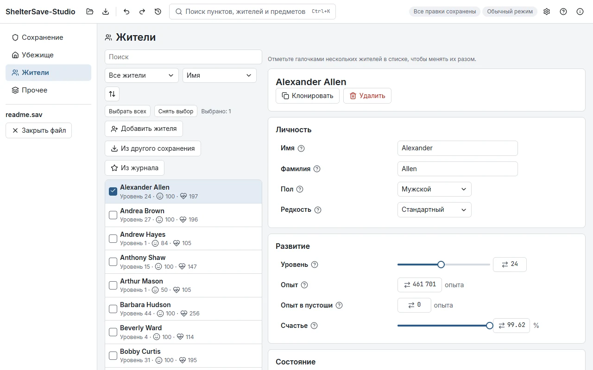
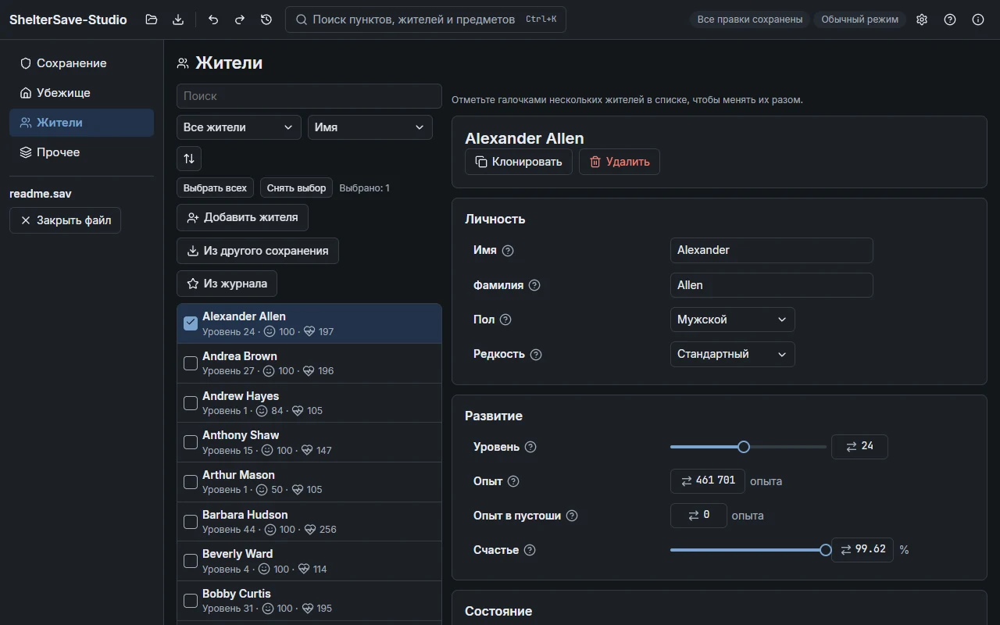
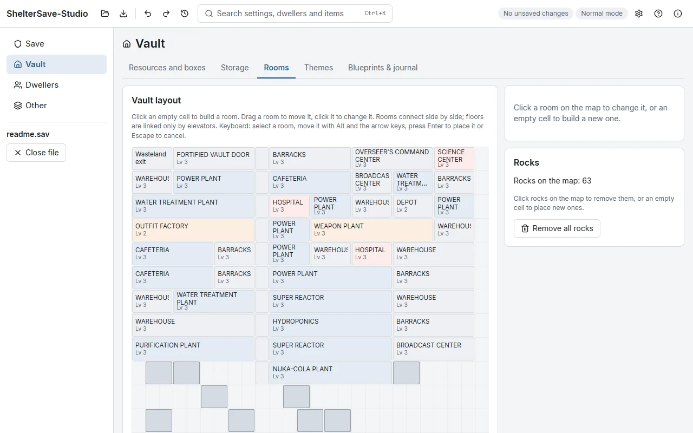

# ShelterSave-Studio

**Редактор сохранений Fallout Shelter для Windows, Linux, macOS и браузера**
 
**Fallout Shelter save editor for Windows, Linux, macOS and the web**

### [Скачать / Download](https://github.com/Mahiron-hq/ShelterSave-Studio/releases/latest) · [Открыть в браузере / Open in browser](https://shelter.mahiron.online)

**[Русский](#русский)** · **[English](#english)**

---

## Русский

ShelterSave-Studio — редактор файлов сохранения Fallout Shelter. Он показывает всё, что хранится в сохранении, и позволяет изменить любую часть убежища: ресурсы, склад, комнаты, жителей, питомцев, задания, отряды в пустоши, происшествия и таймеры.

Главная задача редактора — менять сохранение так, чтобы игра загружала его без ошибок. Для этого он опирается на данные и код самой игры: знает допустимые значения, правила постройки комнат и связи между частями файла, а перед записью проверяет сохранение на ошибки, из-за которых игра вылетает или зависает.

Редактор доступен в двух вариантах с одинаковыми возможностями: программа для Windows, Linux и macOS и [сайт](https://shelter.mahiron.online/ru/), который работает в браузере без установки.

| Светлая тема | Тёмная тема |
|---|---|
|  |  |
|  |  |

### Содержание

- [Почему ShelterSave-Studio](#почему-sheltersave-studio)
- [Сравнение с другими редакторами](#сравнение-с-другими-редакторами)
- [Что можно изменить](#что-можно-изменить)
- [Установка](#установка)
- [Как пользоваться](#как-пользоваться)
- [Ограничения](#ограничения)
- [Конфиденциальность, лицензия и права](#конфиденциальность)

### Почему ShelterSave-Studio

#### 1. Сохранение остаётся рабочим

Неправильная правка сохранения часто приводит не к ошибке в редакторе, а к вылету или зависанию игры при загрузке, причём уже после того, как файл перезаписан. ShelterSave-Studio защищает от этого на нескольких уровнях.

- **Правила взяты из самой игры.** Справочник редактора собран из данных и кода Fallout Shelter 2.7: все предметы, комнаты, задания, цели и достижения, допустимые размеры и уровни каждой комнаты, пределы характеристик, формулы здоровья и производства. Значения не угаданы и не переписаны с вики.
- **Обычный режим не даёт записать недопустимое значение.** Уровень жителя — от 1 до 50, характеристики S.P.E.C.I.A.L. — от 1 до 10, жителей — не больше 200, ресурсы — в пределах, которые принимает игра. Комнату нельзя поставить поверх другой, оторвать от лифта или построить в размере, которого нет в игре.
- **Связанные данные меняются вместе, как в игре.** При повышении уровня пересчитывается максимальное здоровье с учётом выносливости. Надетый питомец получает всё, что игра для него создаёт. Убранный житель исчезает из комнат, отрядов и списков заданий.
- **Проверка целостности перед записью.** Редактор проверяет файл по 25 правилам, найденным в коде игры, и большинство ошибок исправляет одной кнопкой. Примеры: построена комната, которую игра ещё не открыла в книге чертежей (вылет при загрузке); мастерская или парикмахерская не того размера (игра зависает); житель числится в двух комнатах; питомец принадлежит несуществующему жителю; число ящиков не совпадает со списком. Проверка работает с любым файлом, в том числе изменённым другими редакторами.
- **Файл не меняется сверх того, что вы изменили.** Редактор хранит сохранение в исходном виде: запись чисел, порядок ключей, неизвестные ему поля и экранирование символов остаются такими, какими их записала игра. Если ничего не менять, записанный файл совпадёт с исходным до байта. Другие браузерные редакторы заново собирают весь файл через `JSON.stringify`, из-за чего меняются и те части, которых вы не касались.
- **Всё можно проверить и отменить.** Любую правку можно отменить и повторить, журнал показывает все действия по порядку. Перед записью открывается список изменений в формате «было → стало» с понятными названиями мест в файле. ПК-версия перед записью делает резервную копию исходного файла.

#### 2. Изменить можно всё, а не только ресурсы

Большинство редакторов ограничиваются ресурсами, характеристиками жителей и кнопками «открыть всё». ShelterSave-Studio работает со всем содержимым сохранения, в том числе с частями, которые больше нигде не редактируются: карта убежища, задания и ежедневные цели, достижения, будущие дети, происшествия, добыча и дневник отрядов в пустоши, таймеры событий. Полный список — в разделе [«Что можно изменить»](#что-можно-изменить). Для того, чего нет в интерфейсе, есть экспертный режим с доступом к любому ключу файла.

#### 3. Наглядно и понятно

- **Карта убежища.** Комнаты видны так же, как в игре. Комнату можно перетащить мышью, объединить, разделить, скопировать, построить новую и убрать завалы; редактор сразу показывает, где комната помещается.
- **Картинки из вашей игры.** Значки предметов, изображения комнат и тем, житель в полный рост в своей одежде, причёске и с питомцем, фразы дневника отряда. Редактор не содержит файлов игры: он читает их из установленной у вас игры.
- **Пояснение к каждому полю.** Что значит параметр, как его использует игра и какие значения допустимы. Названия предметов, комнат и заданий совпадают с официальной русской локализацией.
- **Поиск по всему сохранению:** разделы, жители, предметы. Ctrl+F в ПК-версии, Ctrl+K на сайте.
- **Массовые действия** над выбранными жителями: уровень, S.P.E.C.I.A.L. на максимум, здоровье, радиация, счастье, снаряжение.

#### 4. Две версии — один результат

ПК-версия и сайт построены на одном ядре, поэтому дают одинаковый файл после одинаковых правок.

- **ПК-версия** работает без интернета, сама находит сохранения, делает резервные копии, замечает, когда игра записала файл, и предлагает загрузить новую версию с переносом ваших правок. Если программа закрылась аварийно, несохранённые правки восстанавливаются при следующем запуске.
- **Сайт** не требует установки. Файл расшифровывается и изменяется только в вашем браузере и никуда не отправляется.

#### 5. Открытый код и уважение к данным

Исходный код открыт под лицензией GPL-3.0. ПК-версия не выполняет ни одного сетевого запроса. Сайт не использует cookie и не собирает персональных данных; анонимный подсчёт посещений можно отключить.

### Сравнение с другими редакторами

Сравнение составлено по исходному коду и описаниям редакторов в ноябре 2026 года. «Частично» означает, что возможность есть в упрощённом виде, подробности указаны в ячейке.

| Возможность | ShelterSave-Studio | [Shelter Editor](https://github.com/rakion99/shelter-editor) | [Wasteland Editor](https://github.com/devvyyxyz/wasteland-editor) |
|---|---|---|---|
| Где работает | Windows, Linux, macOS, браузер | Браузер | Браузер |
| Последнее обновление | 2026 | 2019 | 2026 |
| Язык интерфейса | Русский, английский | Английский | Английский |
| Ресурсы | Да | Да | Да |
| Склад: добавить и убрать предметы | Да | Нет | Да |
| Комнаты | Карта: перемещение, объединение, разделение, постройка, копирование, завалы | Только убрать все завалы | Список и схема; размер можно менять числом |
| Темы комнат | Выбор темы для каждого типа комнаты, детали тем | Открыть все сразу | Открыть все сразу |
| Рецепты | По одному | Все сразу | По одному |
| Характеристики S.P.E.C.I.A.L. | Каждая отдельно | Только «всё на максимум» | Каждая отдельно |
| Внешность жителя | Причёска, борода и маски, цвета кожи, волос и одежды, предпросмотр | Цвет кожи и волос | Причёска, цвет кожи и волос |
| Питомцы | Надеть, снять, бонус, имя | Нет | Нет |
| Мистер Помощник | Имя, здоровье, ремонт, сбор ресурсов | Только количество в ящиках | Только количество в ящиках |
| Беременность и дети | Беременность, будущие дети (редкость, близнецы, цвета), партнёры | Только отметки беременности | Только отметки беременности |
| Задания, ежедневные цели, достижения | Да | Нет | Нет |
| Отряды в пустоши | Состав, время, снаряжение, добыча, дневник | Время и снаряжение | Статус и отзыв отряда |
| Происшествия | Начать в нужной комнате, сила, завершить, пауза случайных | Завершить все | Завершить все |
| Перенос жителя из другого сохранения | Да | Нет | Нет |
| Легендарные жители и питомцы из журнала | Да | Нет | Нет |
| Отмена и повтор правок | Да | Нет | Нет |
| Список изменений перед записью | Да, «было → стало» | Нет | Отметки у изменённых полей и журнал |
| Проверка файла | 25 правил из кода игры, с исправлением | Только проверка, что файл читается | Наличие основных разделов, без исправления |
| Пределы значений из данных игры | Да | Нет | Частично |
| Неизменённые части файла остаются как были | Да | Нет, файл собирается заново | Нет, файл собирается заново |
| Картинки из игры | Да, из вашей копии игры | Нет | Нет |
| Резервные копии | На диске, перед каждой записью | Нет | В памяти страницы, до перезагрузки |
| Лицензия | GPL-3.0 | AGPL-3.0 | Не указана |

Ещё два известных проекта не включены в таблицу: [FSSE](https://github.com/robot9706/FSSE) (Windows и Android) находится в архиве с 2020 года и не обновляется, а [FOSE](https://github.com/goobycorp/fose) — скрипт командной строки, который только расшифровывает и зашифровывает файл; содержимое нужно править вручную.

### Что можно изменить

- **Убежище:** название и номер, ресурсы, ящики, Мистер Помощник и переноски питомцев, склад с поиском и фильтрами.
- **Комнаты:** карта убежища, тип, размер, уровень, тема, разрушения и обесточивание, производство и запас ресурсов, таймеры тренировок, крафта и радиостудии.
- **Чертежи и журнал:** изучение комнат, рецепты оружия, брони и тем, отметка «просмотрено», завершение коллекции.
- **Жители:** имя, пол, уровень, опыт, S.P.E.C.I.A.L., здоровье, радиация, счастье, редкость, внешность с предпросмотром, оружие, одежда и головной убор, питомец, комната, партнёр, родители и предки, возвращение погибших.
- **Семьи:** беременность и время до родов, будущие дети, дети и время до взросления.
- **Пустошь:** отряды, их время, здоровье, стимуляторы и антирадин, найденные предметы и детали тем, дневник отряда.
- **Задания и цели:** текущие, ежедневные и еженедельные задания, замена и выполнение целей, сложность, история пройденных заданий, достижения с прогрессом.
- **События:** происшествия в комнатах, пауза случайных происшествий, Незнакомец, когти смерти, Ботл и Кэппи, беженцы, ежедневный отчёт убежища.
- **Экспертный режим:** дерево JSON с доступом к любому ключу, экспорт и импорт расшифрованного JSON.

### Установка

Все файлы находятся на странице [последнего выпуска](https://github.com/Mahiron-hq/ShelterSave-Studio/releases/latest).

| Система | Какой файл скачать |
|---|---|
| Windows 10 и 11 (x64) | `ShelterSave-Studio-1.0.0-windows-x64-setup.exe` — установщик; `ShelterSave-Studio-1.0.0-windows-x64-portable.exe` — работает без установки |
| Linux (x64) | `…-linux-x64.AppImage` — любой дистрибутив; `…-linux-x64.deb` — Debian, Ubuntu, Mint; `…-linux-x64.rpm` — Fedora, openSUSE |
| macOS 11 и новее, Apple Silicon (M1 и новее) | `…-macos-arm64.dmg` или `…-macos-arm64.zip` |
| macOS 11 и новее, Intel | `…-macos-x64.dmg` или `…-macos-x64.zip` |
| Браузер | Скачивать ничего не нужно: [shelter.mahiron.online](https://shelter.mahiron.online/ru/) |

- **Windows.** Установщик ставит программу для текущего пользователя и не требует прав администратора. Он создаёт ярлыки, по желанию связывает файлы `.sav` с программой и удаляется через «Параметры → Приложения».
- **Linux.** `.deb`: `sudo apt install ./ShelterSave-Studio-1.0.0-linux-x64.deb`. `.rpm`: `sudo dnf install ./ShelterSave-Studio-1.0.0-linux-x64.rpm`. AppImage: разрешите запуск (`chmod +x`) и откройте файл.
- **macOS.** Откройте `.dmg` и перетащите программу в папку «Программы» либо распакуйте `.zip`.

#### Если система предупреждает о неизвестном издателе

Программа не подписана платным сертификатом разработчика, поэтому Windows и macOS при первом запуске покажут предупреждение. Это ожидаемо. Убедиться, что файл не подменён, можно по контрольной сумме из `SHA256SUMS.txt` на странице выпуска: `Get-FileHash -Algorithm SHA256 <файл>` в PowerShell или `sha256sum <файл>` в Linux и macOS.

- **Windows (SmartScreen):** нажмите «Подробнее», затем «Выполнить в любом случае».
- **macOS 15 и новее:** закройте сообщение о том, что программу не удалось проверить, откройте «Системные настройки → Конфиденциальность и безопасность», внизу нажмите «Всё равно открыть» и подтвердите паролем. На macOS 11–14: щёлкните программу правой кнопкой мыши и выберите «Открыть». Другой способ — команда в Терминале: `xattr -dr com.apple.quarantine /Applications/ShelterSave-Studio.app`.

### Как пользоваться

1. **Закройте игру.** Запущенная игра при выходе запишет своё состояние поверх изменённого файла.
2. **Откройте сохранение.** ПК-версия сама показывает найденные убежища. На сайте перетащите файл на страницу или нажмите «Выбрать файл». Где лежат сохранения:
   - Windows (Steam и Bethesda.net): `%LOCALAPPDATA%\FalloutShelter`;
   - Linux (Steam, Proton): `~/.steam/steam/steamapps/compatdata/588430/pfx/drive_c/users/steamuser/AppData/Local/FalloutShelter`;
   - Android: `Android/data/com.bethsoft.falloutshelter/files` (на Android 11 и новее папка доступна только с компьютера по USB).
3. **Внесите изменения.** Наведите указатель на знак вопроса рядом с полем, чтобы прочитать пояснение.
4. **Запишите файл.** Редактор покажет все изменения и результат проверки. ПК-версия записывает файл на место, предварительно сделав резервную копию. Сайт предлагает скачать файл: положите его в папку сохранений вместо старого.
5. **Запустите игру.** Если сохранения синхронизируются через облако, на время правки отключите синхронизацию, иначе облачная копия может заменить ваш файл.

**Имена файлов.** В игре три ячейки сохранения, и она загружает только файлы `Vault1.sav`, `Vault2.sav` и `Vault3.sav`. Редактор открывает файл с любым именем, например резервную копию, но перед запуском игры файл должен лежать в папке сохранений под именем нужной ячейки.

Подробная справка: [shelter.mahiron.online/ru/help/](https://shelter.mahiron.online/ru/help/).

### Ограничения

- Редактор рассчитан на версию игры 2.7 для ПК (Steam, Bethesda.net). Android-версия использует тот же формат файла. Сохранения консольных версий и iOS не проверялись.
- Картинки игры в ПК-версии появляются, если игра установлена на этом компьютере. Сайт показывает их после того, как вы выберете файл `FalloutShelter_Data/data.unity3d` из папки ПК-версии игры; в Android-версии такого файла нет. Все остальные функции работают и без картинок.
- Сайт, в отличие от ПК-версии, не может сам найти сохранения, записать файл на место или заметить, что игра его перезаписала: браузер не даёт сайтам доступа к папкам на диске.
- Как часто случаются происшествия, приходят гости и беженцы, задаётся настройками игры, а не сохранением. Редактор меняет только текущие таймеры и шансы.
- В предпросмотре жителя не рисуются большие головные уборы.

### Конфиденциальность

ПК-версия не выходит в интернет. На сайте файл сохранения обрабатывается только в браузере и не передаётся на сервер. Сайт не ставит cookie и считает посещения анонимно, подсчёт можно отключить. Подробно: [PRIVACY.md](PRIVACY.md).

### Отказ от ответственности

Программа предоставляется «как есть», без гарантий. Перед правкой сохраните копию исходного файла.

ShelterSave-Studio — независимый проект с открытым кодом. Он не связан с ZeniMax Media Inc., Bethesda Softworks LLC, Bethesda Game Studios, Behaviour Interactive Inc. и Microsoft Corporation и не одобрен ими.

Fallout Shelter разработана Bethesda Game Studios при участии Behaviour Interactive, издатель — Bethesda Softworks LLC, компания группы ZeniMax Media (с 2021 года входит в Microsoft). Fallout, Fallout Shelter и связанные логотипы являются товарными знаками или зарегистрированными товарными знаками Bethesda Softworks LLC в США и других странах. Bethesda, Bethesda Softworks, Bethesda Game Studios и ZeniMax являются товарными знаками или зарегистрированными товарными знаками ZeniMax Media Inc. Все названия упоминаются только для обозначения совместимости.

### Лицензия

GPL-3.0-or-later, см. [LICENSE](LICENSE). Лицензии сторонних компонентов: [THIRD_PARTY.md](THIRD_PARTY.md). Сообщить об уязвимости: [SECURITY.md](SECURITY.md). История изменений: [CHANGELOG.md](CHANGELOG.md). Формат файла сохранения описан в [docs/SAV_FORMAT.md](docs/SAV_FORMAT.md), установка сервера сайта — в [deploy/INSTALL.ru.md](deploy/INSTALL.ru.md).

---

## English

ShelterSave-Studio is an editor for Fallout Shelter save files. It shows everything stored in a save and lets you change any part of the vault: resources, storage, rooms, dwellers, pets, quests, wasteland teams, incidents and timers.

Its main goal is to change a save so that the game still loads it without errors. To do that it relies on the game's own data and code: it knows the allowed values, the room building rules and how the parts of the file depend on each other, and before writing it checks the save for problems that make the game crash or hang.

The editor comes in two versions with the same features: a program for Windows, Linux and macOS, and a [website](https://shelter.mahiron.online/en/) that runs in the browser with nothing to install.

| Light theme | Dark theme |
|---|---|
|  |  |
|  |  |

### Contents

- [Why ShelterSave-Studio](#why-sheltersave-studio)
- [Comparison with other editors](#comparison-with-other-editors)
- [What you can edit](#what-you-can-edit)
- [Installation](#installation)
- [How to use](#how-to-use)
- [Limitations](#limitations)
- [Privacy, license and rights](#privacy)

### Why ShelterSave-Studio

#### 1. Your save keeps working

A wrong edit usually does not show up as an error in the editor. It shows up later as a crash or a hang when the game loads the file, after the file has already been overwritten. ShelterSave-Studio guards against this on several levels.

- **The rules come from the game itself.** The editor's catalog is built from the data and code of Fallout Shelter 2.7: every item, room, quest, objective and achievement, the allowed sizes and levels of each room, stat limits, health and production formulas. Nothing is guessed or copied from a wiki.
- **Normal mode does not let you write an invalid value.** Dweller level is 1 to 50, S.P.E.C.I.A.L. stats are 1 to 10, the vault holds at most 200 dwellers, resources stay within what the game accepts. A room cannot be placed over another one, cut off from the elevator or built in a size the game does not have.
- **Linked data changes together, the way the game does it.** Levelling up recalculates maximum health with Endurance. An equipped pet gets everything the game creates for it. A removed dweller disappears from rooms, teams and quest lists.
- **Integrity check before writing.** The editor checks the file against 25 rules found in the game code and fixes most problems with one button. Examples: a room is built that the game has not unlocked in the blueprint book yet (crash on load); a workshop or barbershop of the wrong size (the game hangs); a dweller listed in two rooms; a pet owned by a dweller who does not exist; the lunchbox count does not match the list. It works on any file, including one changed by other editors.
- **The file changes only where you changed it.** The editor keeps the save exactly as it was read: number formatting, key order, fields it does not know and character escaping stay as the game wrote them. With no edits, the written file is byte-identical to the original. Other browser editors rebuild the whole file with `JSON.stringify`, which also changes parts you did not touch.
- **Everything can be reviewed and undone.** Every edit can be undone and redone, and the history lists all actions in order. Before writing you see a list of changes as "before → after" with readable names of the places in the file. The desktop version backs up the original file before writing.

#### 2. Edit everything, not just resources

Most editors stop at resources, dweller stats and "unlock all" buttons. ShelterSave-Studio works with the whole save, including parts no other editor touches: the vault map, quests and daily objectives, achievements, future children, incidents, wasteland team loot and journal, event timers. The full list is in [What you can edit](#what-you-can-edit). For anything the interface does not cover there is expert mode with access to every key of the file.

#### 3. Clear and visual

- **Vault map.** Rooms look the way they do in the game. Drag a room with the mouse, merge, split, copy, build a new one or clear rocks; the editor shows right away where a room fits.
- **Pictures from your own game.** Item icons, room and theme pictures, a full-height dweller in their outfit and hairstyle with their pet, wasteland journal phrases. The editor contains no game files: it reads them from the game installed on your computer.
- **An explanation for every field.** What a setting means, how the game uses it and which values are allowed. Item, room and quest names match the official game localization.
- **Search across the whole save:** sections, dwellers, items. Ctrl+F in the desktop version, Ctrl+K on the website.
- **Bulk actions** on selected dwellers: level, max S.P.E.C.I.A.L., health, radiation, happiness, equipment.

#### 4. Two versions, one result

The desktop version and the website share one core, so the same edits give the same file.

- **The desktop version** works offline, finds your saves, makes backups, notices when the game has written the file and offers to load the new version while keeping your edits. If the program closes unexpectedly, unsaved edits are restored on the next start.
- **The website** needs no installation. The file is decrypted and edited only in your browser and is never uploaded.

#### 5. Open source and respect for your data

The source code is open under GPL-3.0. The desktop version makes no network requests at all. The website sets no cookies and collects no personal data; anonymous visit counting can be turned off.

### Comparison with other editors

Compiled from the source code and descriptions of the editors in November 2026. "Partly" means the feature exists in a simpler form; details are in the cell.

| Feature | ShelterSave-Studio | [Shelter Editor](https://github.com/rakion99/shelter-editor) | [Wasteland Editor](https://github.com/devvyyxyz/wasteland-editor) |
|---|---|---|---|
| Runs on | Windows, Linux, macOS, browser | Browser | Browser |
| Last update | 2026 | 2019 | 2026 |
| Interface language | Russian, English | English | English |
| Resources | Yes | Yes | Yes |
| Storage: add and remove items | Yes | No | Yes |
| Rooms | Map: move, merge, split, build, copy, rocks | Only remove all rocks | List and layout view; size can be typed in |
| Room themes | Theme per room type, theme parts | Unlock all at once | Unlock all at once |
| Recipes | One by one | All at once | One by one |
| S.P.E.C.I.A.L. | Each stat separately | Only "max all" | Each stat separately |
| Dweller looks | Hairstyle, beard and masks, skin, hair and outfit colours, preview | Skin and hair colour | Hairstyle, skin and hair colour |
| Pets | Equip, remove, bonus, name | No | No |
| Mr. Handy | Name, health, repair, collecting | Lunchbox count only | Lunchbox count only |
| Pregnancy and children | Pregnancy, future children (rarity, twins, colours), partners | Pregnancy flags only | Pregnancy flags only |
| Quests, daily objectives, achievements | Yes | No | No |
| Wasteland teams | Members, time, gear, loot, journal | Time and gear | Status and recall |
| Incidents | Start in a chosen room, strength, end, pause random ones | End all | End all |
| Move a dweller from another save | Yes | No | No |
| Legendary dwellers and pets from the journal | Yes | No | No |
| Undo and redo | Yes | No | No |
| List of changes before writing | Yes, "before → after" | No | Marks on changed fields and a log |
| File check | 25 rules from the game code, with fixes | Only that the file can be read | Main sections present, no fixes |
| Value limits from game data | Yes | No | Partly |
| Untouched parts of the file stay as they were | Yes | No, the file is rebuilt | No, the file is rebuilt |
| Game pictures | Yes, from your copy of the game | No | No |
| Backups | On disk, before every write | No | In page memory, until reload |
| License | GPL-3.0 | AGPL-3.0 | Not specified |

Two more known projects are not in the table: [FSSE](https://github.com/robot9706/FSSE) (Windows and Android) has been archived since 2020 and is not updated, and [FOSE](https://github.com/goobycorp/fose) is a command-line script that only decrypts and encrypts the file; the contents have to be edited by hand.

### What you can edit

- **Vault:** name and number, resources, lunchboxes, Mr. Handy and pet carriers, storage with search and filters.
- **Rooms:** vault map, type, size, level, theme, damage and power, production and stored output, training, crafting and radio timers.
- **Blueprints and journal:** room unlocks, weapon, outfit and theme recipes, "seen" marks, completing the collection.
- **Dwellers:** name, gender, level, experience, S.P.E.C.I.A.L., health, radiation, happiness, rarity, looks with a preview, weapon, outfit and hat, pet, room, partner, parents and ancestors, reviving dead dwellers.
- **Families:** pregnancy and time to birth, future children, children and time until they grow up.
- **Wasteland:** teams, their time, health, Stimpaks and RadAway, found items and theme parts, team journal.
- **Quests and objectives:** current, daily and weekly quests, replacing and completing objectives, difficulty, history of finished quests, achievements with progress.
- **Events:** incidents in rooms, pausing random incidents, the Mysterious Stranger, deathclaws, Bottle and Cappy, refugees, the daily vault report.
- **Expert mode:** a JSON tree with access to every key, export and import of the decrypted JSON.

### Installation

All files are on the [latest release](https://github.com/Mahiron-hq/ShelterSave-Studio/releases/latest) page.

| System | Which file to download |
|---|---|
| Windows 10 and 11 (x64) | `ShelterSave-Studio-1.0.0-windows-x64-setup.exe` — installer; `ShelterSave-Studio-1.0.0-windows-x64-portable.exe` — runs without installation |
| Linux (x64) | `…-linux-x64.AppImage` — any distribution; `…-linux-x64.deb` — Debian, Ubuntu, Mint; `…-linux-x64.rpm` — Fedora, openSUSE |
| macOS 11 or newer, Apple Silicon (M1 and newer) | `…-macos-arm64.dmg` or `…-macos-arm64.zip` |
| macOS 11 or newer, Intel | `…-macos-x64.dmg` or `…-macos-x64.zip` |
| Browser | Nothing to download: [shelter.mahiron.online](https://shelter.mahiron.online/en/) |

- **Windows.** The installer installs the program for the current user and needs no administrator rights. It creates shortcuts, can associate `.sav` files with the program if you choose so, and is removed through Settings → Apps.
- **Linux.** `.deb`: `sudo apt install ./ShelterSave-Studio-1.0.0-linux-x64.deb`. `.rpm`: `sudo dnf install ./ShelterSave-Studio-1.0.0-linux-x64.rpm`. AppImage: make it executable (`chmod +x`) and open it.
- **macOS.** Open the `.dmg` and drag the program to Applications, or unpack the `.zip`.

#### If the system warns about an unknown publisher

The program is not signed with a paid developer certificate, so Windows and macOS show a warning on the first start. This is expected. To make sure the file has not been tampered with, compare its checksum with `SHA256SUMS.txt` on the release page: `Get-FileHash -Algorithm SHA256 <file>` in PowerShell or `sha256sum <file>` on Linux and macOS.

- **Windows (SmartScreen):** press "More info", then "Run anyway".
- **macOS 15 and newer:** close the message saying the program could not be verified, open System Settings → Privacy & Security, press "Open Anyway" at the bottom and confirm with your password. On macOS 11–14: right-click the program and choose "Open". Another way is a Terminal command: `xattr -dr com.apple.quarantine /Applications/ShelterSave-Studio.app`.

### How to use

1. **Close the game.** A running game writes its own state over the edited file when it exits.
2. **Open the save.** The desktop version lists the vaults it finds. On the website drag the file onto the page or press "Choose file". Where saves are stored:
   - Windows (Steam and Bethesda.net): `%LOCALAPPDATA%\FalloutShelter`;
   - Linux (Steam, Proton): `~/.steam/steam/steamapps/compatdata/588430/pfx/drive_c/users/steamuser/AppData/Local/FalloutShelter`;
   - Android: `Android/data/com.bethsoft.falloutshelter/files` (on Android 11 and newer the folder is reachable only from a computer over USB).
3. **Make your changes.** Point at the question mark next to a field to read its explanation.
4. **Write the file.** The editor shows all changes and the check result. The desktop version writes the file in place after backing up the original. The website offers the file for download: put it into the saves folder in place of the old one.
5. **Start the game.** If your saves sync through the cloud, turn syncing off while editing, or the cloud copy may replace your file.

**File names.** The game has three save slots and loads only the files `Vault1.sav`, `Vault2.sav` and `Vault3.sav`. The editor opens a file with any name, a backup for example, but before you start the game the file must be in the saves folder under the name of the slot you want.

Full help: [shelter.mahiron.online/en/help/](https://shelter.mahiron.online/en/help/).

### Limitations

- The editor is made for game version 2.7 on PC (Steam, Bethesda.net). The Android version uses the same file format. Console and iOS saves have not been tested.
- The desktop version shows game pictures when the game is installed on the same computer. The website shows them after you pick the `FalloutShelter_Data/data.unity3d` file from the PC game folder; the Android version has no such file. Everything else works without pictures.
- Unlike the desktop version, the website cannot find saves by itself, write the file in place or notice that the game has overwritten it: browsers do not give websites access to folders on disk.
- How often incidents, visitors and refugees happen is set by the game's settings, not by the save. The editor changes only the current timers and chances.
- The dweller preview does not draw large headgear.

### Privacy

The desktop version never goes online. On the website the save file is processed only in the browser and is not sent to the server. The site sets no cookies and counts visits anonymously; counting can be turned off. Details: [PRIVACY.md](PRIVACY.md).

### Disclaimer

The program is provided "as is", without warranty. Keep a copy of the original file before editing.

ShelterSave-Studio is an independent open source project. It is not affiliated with or endorsed by ZeniMax Media Inc., Bethesda Softworks LLC, Bethesda Game Studios, Behaviour Interactive Inc. or Microsoft Corporation.

Fallout Shelter was developed by Bethesda Game Studios with Behaviour Interactive and is published by Bethesda Softworks LLC, a ZeniMax Media company (part of Microsoft since 2021). Fallout, Fallout Shelter and related logos are trademarks or registered trademarks of Bethesda Softworks LLC in the U.S. and/or other countries. Bethesda, Bethesda Softworks, Bethesda Game Studios and ZeniMax are trademarks or registered trademarks of ZeniMax Media Inc. All names are used only to indicate compatibility.

### License

GPL-3.0-or-later, see [LICENSE](LICENSE). Third-party licenses: [THIRD_PARTY.md](THIRD_PARTY.md). Reporting a vulnerability: [SECURITY.md](SECURITY.md). Changes: [CHANGELOG.md](CHANGELOG.md). The save file format is described in [docs/SAV_FORMAT.md](docs/SAV_FORMAT.md), installing the website server in [deploy/INSTALL.en.md](deploy/INSTALL.en.md).

---

Copyright © 2026 Lev Burmistrov (Mahiron-hq)

